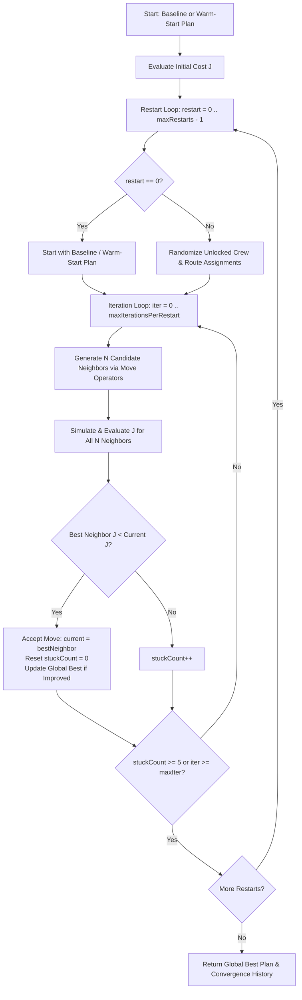

# GridRescue: Post-Storm Infrastructure Dispatch Optimizer

[](https://www.typescriptlang.org/)
[](https://vitejs.dev/)
[](https://vitest.dev/)
[](https://www.openstreetmap.org/copyright)

**GridRescue** is an interactive, mission-critical control-room application that dispatches municipal infrastructure-repair crews after a storm and prioritizes service restoration on **real city road networks and places** (Jaipur, India).

At the heart of the engine is a pure, framework-free **Hill Climbing with Random Restarts** optimizer that navigates complex combinatorial assignment spaces, respects skill alignments, resolves dependency chains, detours around blocked roads, and minimizes downtime at critical facilities.

---

## Key Features

1. **Real-City Road Network & Offline Map Renderer**:
   - Bundled OpenStreetMap road network of Jaipur, India (contracted to intersection topology with speed-calibrated travel times).
   - High-performance offline SVG map renderer using equirectangular projection. Zero external tile servers, zero external SDKs.
   - Dynamic road blockage toggling with real-time route invalidation.

2. **Guaranteed Operational Complexity (12/8/5 Engine)**:
   - **12 Incidents**: 4 Power faults, 3 Water leaks, 2 Telecom outages, and 3 Road debris blockages.
   - **8 Specialized Crews**: Diverse vehicles (bucket trucks, pump vans), equipment (generators, excavators, splicers, chainsaws), and skill match proficiencies.
   - **5 Critical Facilities**: Hospitals, water pumping stations, telecom cores, and government emergency centers with priority weights.
   - **Blocking Road Rule**: Road incidents directly block shortest paths to hospital-linked faults, ensuring that clearing access roads first is necessary for optimal dispatch.

3. **Core Optimizer: Hill Climbing with Random Restarts**:
   - **3 Move Types**:
     - `swap-team`: Reallocates tasks to better-suited or idle crews.
     - `swap-route`: Selects alternative loop-free routes ($k=1..3$) via Yen-lite routing.
     - `swap-order`: Optimizes execution order within crew schedules so pre-requisite incidents and road clearances execute first.
   - **Multiple HC Variants**: Single-start Steepest-Ascent, Random-Restart HC, and Stochastic HC.
   - **Decoupled Web Worker**: Optimization runs entirely in a dedicated Web Worker (`optimizer.worker.ts`), keeping the UI responsive at a locked 60 FPS.

4. **Mathematical Cost Function $J$**:
   $$\min J = \alpha \cdot \text{makespan} + \beta \cdot \sum_{f \in F} (w_f \cdot \Delta_f) + \gamma \cdot U$$
   - $\alpha = 1.0$: Total operation duration (minutes).
   - $\beta = 2.0$: Criticality-weighted facility restoration delay.
   - $\gamma = 500$: Large penalty deterrent per unresolved incident.

5. **Dynamic Mid-Operation Replanning & Warm Starts**:
   - Handles mid-operation disruptions (new emergency transformer faults, fallen trees, pipe bursts) at $t=t_{\text{now}}$.
   - **Locked History**: Work completed prior to $t_{\text{now}}$ is locked as immutable.
   - **Warm Start**: Hill climbing starts directly from the previous plan, adapting pending work in under 50ms.

6. **Plain-Language Explainability Engine**:
   - Computes diffs across all incident assignments (`NEW`, `REASSIGNED`, `REROUTED`, `UNCHANGED`).
   - Generates human-readable narratives explaining *why* crews were diverted and *what* the net KPI impact was.

7. **Security & Hardening**:
   - Strict Content Security Policy (CSP) meta tag.
   - Full Zod runtime validation for scenario import/export and Web Worker message channels.
   - Memory and coordinate bounds checks preventing prototype pollution and denial-of-service.

---

## Hill Climbing in GridRescue: Engine & Variants

### Why Hill Climbing for Disaster Dispatch?
Post-storm municipal infrastructure dispatch is a complex combinatorial problem combining **Multi-Vehicle Routing with Time Windows (VRPTW)**, **heterogeneous crew skills**, **precedence constraints** (e.g., clearing road debris before restoring power lines), and **critical facility priorities** (e.g., hospitals and water pumping stations). 

Exact solvers (MIP / branch-and-bound) scale exponentially and cannot satisfy the real-time requirements of interactive control-room dashboards or sub-50ms mid-operation replanning. GridRescue implements a pure, deterministic TypeScript hill climbing engine ([`src/core/hillclimb/hillClimb.ts`](file:///c:/Users/kushg/Downloads/AISC/src/core/hillclimb/hillClimb.ts)) that delivers fast, high-quality heuristic improvements with full convergence telemetry.

---

### Core Hill Climbing Workflow



At every step of the search:
1. **Discrete-Event Simulation**: Candidate plans are evaluated via `simulate()`, calculating exact crew transit times over the road network, service duration adjusted by crew skill proficiencies, road blockage delays, and facility downtime.
2. **Objective Evaluation ($J$)**: The simulation output is evaluated against the multi-objective cost function $J$ penalizing makespan, facility restoration delays, and unserved incidents.
3. **Strict Improvement Acceptance**: Only moves that strictly reduce total cost ($J_{\text{neighbor}} < J_{\text{current}}$) are accepted.
4. **Local Optimum Detection**: If 5 consecutive iterations fail to produce an improving neighbor (`stuckCount >= 5`), the algorithm declares convergence on a local optimum for that restart trajectory and triggers the next restart.
5. **Shared Routing Cache**: To maximize performance (~700–850 iterations/sec), an immutable `RouteCache` is shared across all evaluations, caching Dijkstra and Yen's $k$-shortest paths.

---

### Hill Climbing Variants Implemented

The application provides four selectable strategies in the UI ([`src/App.tsx`](file:///c:/Users/kushg/Downloads/AISC/src/App.tsx)), exposing different trade-offs between speed and solution quality:

| Strategy | `maxRestarts` | `maxIterationsPerRestart` | `neighborsPerStep` | Algorithmic Description |
|---|:---:|:---:|:---:|---|
| **Baseline (Greedy)** | `0` | `0` | `0` | **No optimization.** Uses a nearest-first greedy heuristic where each crew greedily picks the closest accessible incident matching their skill set. Serves as the comparison reference benchmark. |
| **Hill Climbing (Steepest-Ascent)** | `1` | `60` | `6` | **Single-start greedy hill climbing.** Begins at the baseline plan and generates 6 candidate neighbors at each step, adopting the best improving neighbor. It converges rapidly into the nearest local optimum. |
| **Random-Restart HC** | `5` | `40` | `6` | **Multi-start hill climbing.** Executes 5 distinct hill climbing trajectories. Restart 0 starts at the baseline, while restarts 1–4 perturb crew allocations and routes with a pseudo-random seed. Escapes local optima and basins of attraction. |
| **Stochastic HC** | `5` | `50` | `12` | **Wide-sample stochastic search with restarts.** Doubles the neighborhood sample size (`neighborsPerStep: 12`) and extends iterations per restart (`50`). Explores twice as many stochastic candidates per iteration, finding higher-quality assignments across complex constraints. |

---

### The Three Neighborhood Move Operators

Neighbors are generated dynamically by randomly selecting one of three domain-specific mutation operators ([`src/core/hillclimb/hillClimb.ts`](file:///c:/Users/kushg/Downloads/AISC/src/core/hillclimb/hillClimb.ts)):

1. **`swapTeamMove` (Inter-crew Reassignment)**:
   - Selects a random unlocked incident and reassigns it to a different eligible crew.
   - *Operational Goal*: Balances workload across crews, reassigns tasks to crews with higher skill compatibility multipliers, and relieves bottlenecked teams.

2. **`swapRouteMove` (Alternative Path Selection)**:
   - Modifies the travel path index of an assignment to an alternative $k$-shortest route ($k \in \{0, 1, 2\}$).
   - *Operational Goal*: Routes crews around newly formed debris blockages or road damage without reassigning the incident itself.

3. **`swapOrderMove` (Task Sequence Permutation)**:
   - Swaps the execution order of two unlocked incidents within or between crew schedules.
   - *Operational Goal*: Resolves precedence bottlenecks—for example, scheduling a road debris clearance crew before a utility van that requires that road to reach a critical hospital fault.

---

### Determinism & Mid-Operation Replanning (Warm Starts)

- **Mulberry32 PRNG**: All random moves and restart perturbations use a 32-bit deterministic PRNG initialized with `scenario.seed`. Optimization runs are 100% reproducible for the same scenario seed and configuration.
- **Warm-Start Replanning**: When unexpected events occur during execution (e.g., severe road blockage at $t=18$ min), the replanner locks all completed tasks (`lockedIncidentIds`) and runs Hill Climbing on the remaining pending tasks starting directly from the currently active plan rather than the greedy baseline. This produces optimal route diversions in $<50$ms.

---

## Architecture

```
├── data/
│   ├── city.json              # Contracted Jaipur road network
│   ├── places.json            # Geo-referenced infrastructure places
│   └── ATTRIBUTION.md         # OpenStreetMap attribution (ODbL)
├── docs/
│   ├── PLAN.md                # Phase checklist & architecture
│   ├── CONTEXT.md             # Concise state & key architectural decisions
│   └── DEMO.md                # Interactive walkthrough demo script
├── scripts/
│   ├── benchmark.ts           # Standalone performance & throughput benchmark
│   ├── build-map-data.ts      # Pipeline for fetching/contracting OSM data
│   └── generate-mini-city.ts  # Fixture generator for fast testing
├── src/
│   ├── core/
│   │   ├── baseline/          # Nearest-first greedy dispatcher & KPI metrics
│   │   ├── cost/              # Objective function J evaluation
│   │   ├── explain/           # Plain-language explainer & plan diff engine
│   │   ├── graph/             # Spatial indexing & R-tree node picking
│   │   ├── hillclimb/         # Hill Climbing optimizer & move generators
│   │   ├── model/             # Domain schemas & Zod validators
│   │   ├── plan/              # Timeline simulator & discrete-event engine
│   │   ├── replan/            # Dynamic replanning with warm start
│   │   ├── rng/               # Deterministic Mulberry32 PRNG
│   │   ├── routing/           # Dijkstra & k-alternative routes
│   │   └── scenario/          # 12/8/5 Jaipur scenario generator & JSON I/O
│   ├── state/                 # Zustand application state store
│   ├── ui/                    # MapRenderer, ComparisonTable, ExplainPanel
│   └── workers/               # optimizer.worker.ts & OptimizerRunner client
└── tests/                     # 82 automated unit, integration, and benchmark tests
```

---

## Quick Start

### Prerequisites
- Node.js v18 or later
- npm v9 or later

### Installation
```bash
git clone https://github.com/example/grid-rescue.git
cd grid-rescue
npm install
```

### Development Server
```bash
npm run dev
```
Open [http://localhost:5173](http://localhost:5173) in your browser.

### Test Suite
Run all 82 unit and integration tests across 12 test suites:
```bash
npm run test
```

### Performance Benchmark
Run the command-line optimization benchmark:
```bash
npm run benchmark
```
*Expected output: ~700–850 iterations/sec, >30% cost reduction in <40ms.*

### TypeScript & Lint Verification
```bash
npm run typecheck
npm run lint
```

### Production Build
```bash
npm run build
```

---

## Attribution & Data

- **Map Data**: [OpenStreetMap](https://www.openstreetmap.org/) contributors, licensed under the [Open Database License (ODbL)](https://opendatacommons.org/licenses/odbl/).
- See [data/ATTRIBUTION.md](file:///c:/Users/kushg/Downloads/AISC/data/ATTRIBUTION.md) for full licensing terms.
